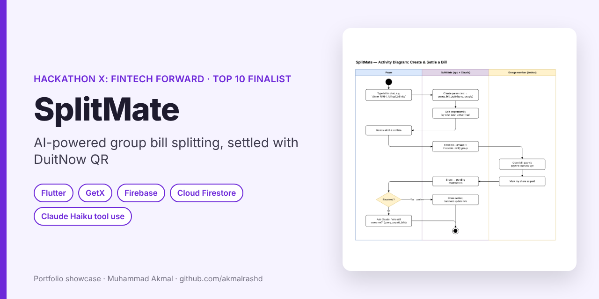
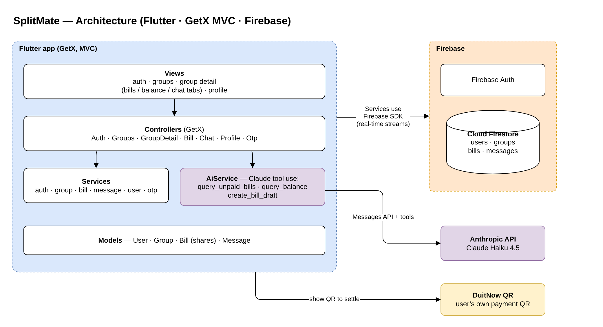
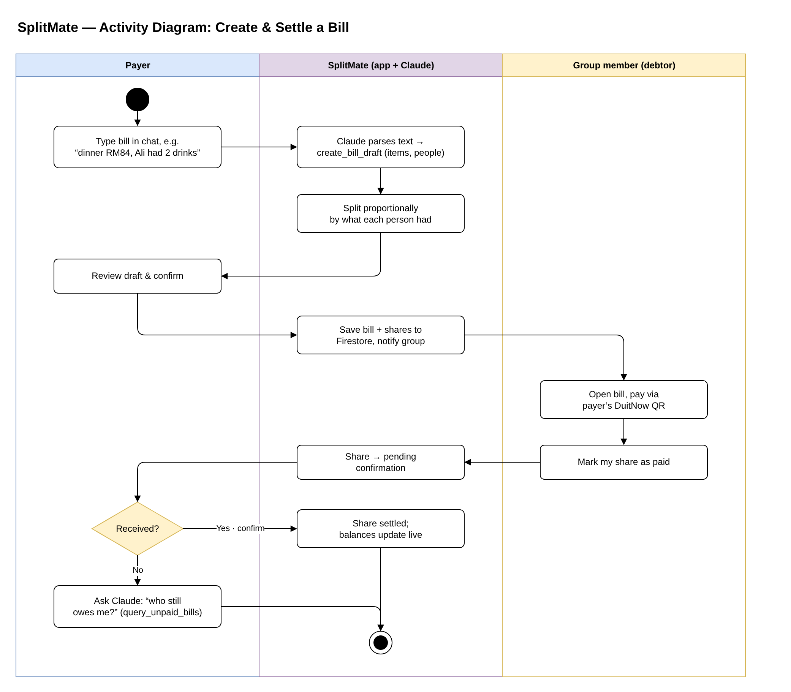

# SplitMate — AI-Powered Group Bill Splitting

> **Portfolio showcase** of a hackathon team project. The original code repository belongs to the team, so only the design is shown here.

🏆 **Hackathon X: Fintech Forward** (PETAKOM, UMPSA) — **Top 10 finalist** among universities across Malaysia  
**Type:** Team project · **Period:** April – June 2026

---

## The idea

Splitting a group bill fairly is annoying when people order different things. In SplitMate you just type the bill in plain language, for example *"dinner RM84, Ali had 2 drinks"*. Claude turns it into a structured bill draft, the app splits it **in proportion to what each person had**, and members settle by scanning the payer's **DuitNow QR**.

## Features

- Groups with real-time chat, bills and balance tabs (Cloud Firestore streams)
- Natural-language bill entry using **Claude tool use** (`create_bill_draft`)
- Ask questions in chat such as *"who still owes me?"* (`query_unpaid_bills`, `query_balance`)
- Proportional split per item, not just equal split
- Two-step settlement: the debtor marks a share as paid, the payer confirms it was received
- Phone sign-in and profile with the user's own DuitNow QR

## System design

Editable draw.io sources are in [`docs/diagrams`](docs/diagrams).

### Architecture

### Activity diagram — create and settle a bill

## What I learned

- Designing **LLM tool calls** with strict schemas so the model returns data the app can trust, rather than free text.
- Structuring a Flutter app with **GetX MVC** (views → controllers → services → models) so several people can work in parallel during a hackathon.
- Modelling settlement as a small state machine (unpaid → pending confirmation → settled) to avoid disputes.

## How we used AI tools

AI coding assistants helped with boilerplate and debugging during the hackathon. The bill-parsing assistant is a **product feature** we built on the Anthropic API.

## Contact

**Muhammad Akmal bin Mohd Rashid** — Software Engineering student, UMPSA  
📧 work.akmalrashd@gmail.com · 💼 [linkedin.com/in/akmalrashd](https://www.linkedin.com/in/akmalrashd)
